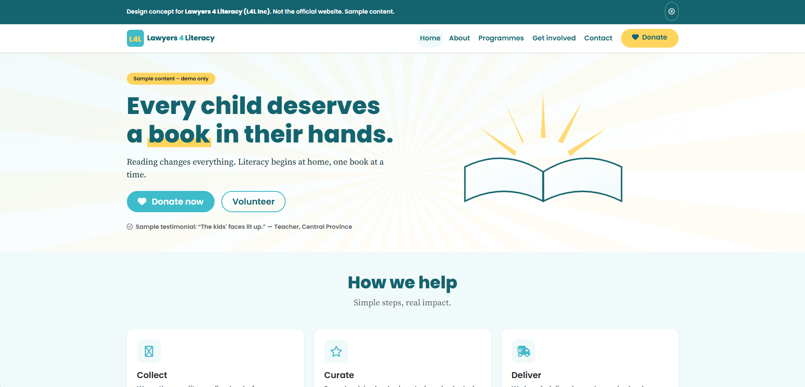
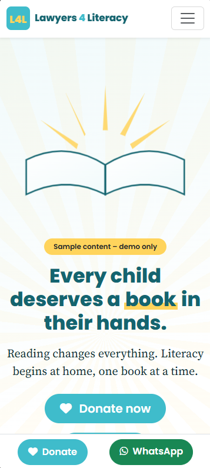

# Lawyers 4 Literacy (L4L Inc) — Design Concept

A hopeful, trustworthy, donation-first website for a PNG literacy non-profit, built so a donor can commit in three taps or fewer.

**Status:** Design concept — not the official website. Built by **Tesseract Cloud Technologies, Port Moresby**. Live demo: `https://tesseract-cloud-technologies.github.io/lawyers-4-literacy/`.





---

## 1. Project overview

Lawyers 4 Literacy (L4L Inc) is a Papua New Guinean non-profit founded by lawyers. Its main programme is a book donation drive that supplies reading books to rural schools. Fundraisers include sponsored climbs, and the organisation takes part in Literacy Week advocacy each September.

The site serves three audiences: corporate donors, law firms, parents and school heads, and volunteers. The concept exists to turn a first-time visitor into a confident donor or volunteer within a short session, and to give the organisation a reviewable blueprint before any production build.

Everything on this site is **sample content** unless explicitly marked otherwise. No statistics, awards, testimonials, dates, sponsor names, or figures have been invented beyond what was supplied in the brief.

---

## 2. Objectives and goals

**Business goals**
- Increase donations and book drop-offs.
- Recruit volunteers.
- Showcase sponsors.

**Design goals**
- Build credibility within five seconds through clear structure, warm tone, and visible programme detail.
- Feel hopeful rather than pitying — celebrate reading, not deficit.
- Let a donor commit in three taps or fewer.

**Suggested success measures for a live version**
- Home page to pledge modal open rate.
- Pledge completion rate.
- Book drop-off page views and contact form submissions.
- Volunteer sign-up conversions.
- Sponsor marquee click-throughs.

These are suggested measures, not supplied data.

---

## 3. Users and user goals

| Persona | Situation | Goal | How the interface helps |
|---|---|---|---|
| Corporate CSR / HR manager | Looking for a credible PNG cause to support; needs to justify the choice internally | Understand the programme quickly and see sponsor credibility | Sponsor marquee, programme cards, and a short impact line visible on the home page |
| Parent or teacher | Wants to donate books or request books for a rural school | Find drop-off locations or request books without hunting | Get Involved page lists drop-off and volunteer paths; Contact form captures requests |
| Young lawyer or student | Wants to volunteer time or join a sponsored climb | Sign up with minimal friction | Clear volunteer CTA on the home page and Get Involved page |

**Top three user tasks and target taps/clicks**
1. From home page to pledge modal — **2 taps** (tap amount chip, tap pledge button).
2. From home page to book drop-off details — **2 taps** (Get Involved → Drop off).
3. From home page to volunteer sign-up — **3 taps** (Get Involved → Volunteer → Submit).

---

## 4. Brand and visual identity

Brand cues came from the brief: a non-profit founded by lawyers, warm and hopeful in tone, with an open-book motif and a sun-ray pattern. The visual language leans on Teal and Sun Yellow for optimism, with Deep Teal for authority and readability.

**Colour palette**

| Swatch | Name | Hex | Role | Contrast note |
|---|---|---|---|---|
|  | Teal | #3FBCCB | Primary brand colour, buttons, accents | AA on Deep Teal and Ink |
|  | Sun Yellow | #FFD45C | Accent only — underlines, chips, highlights | Never used for text on white |
|  | Deep Teal | #14646F | Headings, dark sections, footer | AA on Mist and White |
|  | Mist | #F1FAFB | Alternate section background | AA with Deep Teal text |
|  | White | #FFFFFF | Page base | AA with Deep Teal text |

**Typography**

| Font | Weights | Where used | Why |
|---|---|---|---|
| Poppins | 600, 800 | Headings, buttons, navigation | Chunky geometric sans that matches the bold wordmark and keeps calls to action legible |
| Source Serif 4 | 400, 600 (regular and italic) | Body paragraphs, pull quotes | Warmer serif that supports the story-driven, hopeful tone without feeling old-fashioned |

**Signature shapes and motifs**
- An open-book silhouette drawn as inline SVG, with sun rays fanning from its spine.
- Section dividers shaped as a gentle page curve.
- A faint radiating-ray background at low opacity.
- Hand-drawn yellow underline strokes beneath key words.
- Cards with a 16px radius and a thin teal top edge.

**Imagery and icons**
No stock photography is used. The hero illustration is inline SVG. Image slots are clearly marked and given gradient fallbacks so the layout can be reviewed without photos. Font Awesome Free 6.5.2 provides the icons (book, star, truck, heart, calendar, mountain, box, handshake, users, sparkles).

**Tone of voice**
Friendly, hopeful, plain PNG English. "Literacy begins at home, one book at a time" rather than "combat illiteracy". Sample content is labelled as sample wherever it appears.

---

## 5. UI design system

**Grid and spacing**
Bootstrap 5.3.3 twelve-column grid. Section rhythm uses `py-5` with `clamp()` on display type. Cards share a 16px radius and a single soft shadow token.

**Breakpoints**
Mobile-first, tested at 320, 360, 390, 768, 1024, 1440 and 1920px. The sponsor marquee stays inside its own overflow container. The counters collapse to a 2×2 grid on phones. The sticky bottom bar appears only on phones.

**Key components and states**

| Component | States |
|---|---|
| Primary button (`btn-teal`) | Default, hover (lift + yellow shadow), focus-visible, active, disabled |
| Accent button (`btn-accent`, Sun Yellow) | Default, hover, focus-visible |
| Amount chip | Default, hover, active/selected |
| Progress bar | Default, filling on scroll, fully filled |
| Pledge modal | Closed, open, invalid, success |
| Sponsor marquee | Scrolling, paused on hover |
| Form input | Default, focus (teal ring), invalid, valid |
| Sticky mobile bar | Visible on phones only |

**Animations and reduced-motion fallbacks**

| Animation | Purpose | Reduced-motion fallback |
|---|---|---|
| Ray fan-out on load (staggered scaleY) | Signals the brand's open-book motif | Disabled — rays static |
| Book settle after rays | Completes the illustration | Disabled — static |
| Counters count up (IntersectionObserver) | Makes impact numbers feel alive | Disabled — final values shown immediately |
| Progress bar fills on scroll | Reinforces progress toward goal | Disabled — bar at final width |
| Sponsor marquee (26s linear) | Keeps sponsors visible without taking space | Animation paused |
| Button lift 2px | Confirms interactivity | Transition duration reduced |

All motion is disabled under `prefers-reduced-motion: reduce`.

**Accessibility decisions**
- Skip link on every page.
- One `<h1>` per page.
- Visible `:focus-visible` ring in Sun Yellow with sufficient contrast offset.
- ARIA labels on all icon buttons.
- Pledge modal is front-end only and clearly states "This is a demo, no real donation has been processed."
- Minimum 44px tap targets.
- AA contrast for text; Sun Yellow never used for body text on white.

---

## 6. Page map and user flows

**Sitemap**

```mermaid
flowchart TD
    Home[index.html] --> About[about.html]
    Home --> Programmes[programmes.html]
    Home --> GetInvolved[get-involved.html]
    Home --> Contact[contact.html]
    Home --> Pledge[Pledge modal]
    GetInvolved --> Pledge
    GetInvolved --> DropOff[Drop-off details]
    GetInvolved --> Volunteer[Volunteer sign-up]
    Programmes --> Pledge